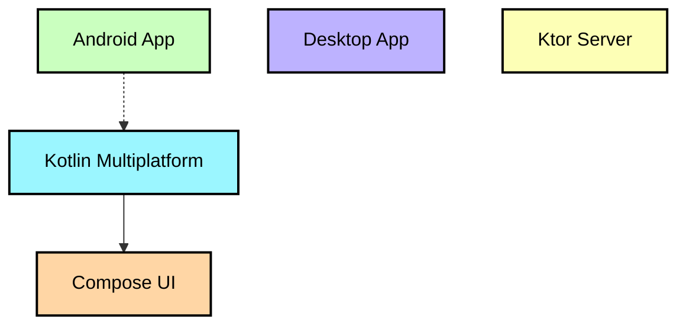

# `:desktopApp`

Desktop（JVM）平台入口点，遵循 [KMP 官方推荐结构](https://kotlinlang.org/docs/multiplatform/multiplatform-project-recommended-structure.html)从 `:composeApp` 中拆出。

- 仅包含启动代码：`src/main/kotlin/.../Main.kt`（`nucleusApplication(backend = NucleusBackend.Tao)` + `DecoratedWindow` + Koin 初始化）
- `src/main/resources/logback.xml` 桌面端日志配置
- 窗口栈使用 **Nucleus Tao** 后端（`dev.nucleusframework` 插件 + `nucleus.application {}` 打包 DSL）：原生 WebView 与 Compose 同窗口栈合成，文章功能的 WebView 浮层（FAB）在桌面正常显示
- 依赖 `:composeApp`（共享 Compose UI 装配）、`compose.desktop.currentOs` 与 Nucleus 三件套（`nucleus.nucleus-application` / `nucleus.decorated-window-tao` / `nucleus.core-runtime`）

```bash
./gradlew :desktopApp:run                            # 运行
./gradlew :desktopApp:packageDistributionForCurrentOS  # 原生打包（Dmg / Msi / Deb）
```

> 运行时系统依赖：Windows 需 WebView2 Runtime（Win11 自带）；Linux 需 WebKit2GTK。

## Module dependency graph

```mermaid
---
config:
  layout: elk
  elk:
    nodePlacementStrategy: SIMPLE
---
graph TB
  subgraph :features
    direction TB
    :features:article[article]:::compose-multiplatform
    :features:article-editor[article-editor]:::compose-multiplatform
    :features:auth[auth]:::compose-multiplatform
    :features:chat[chat]:::compose-multiplatform
    :features:contacts[contacts]:::compose-multiplatform
    :features:conversations[conversations]:::compose-multiplatform
    :features:profile[profile]:::compose-multiplatform
    :features:search[search]:::compose-multiplatform
    :features:settings[settings]:::compose-multiplatform
  end
  subgraph :core
    direction TB
    :core:common[common]:::kotlin-multiplatform
    :core:data[data]:::kotlin-multiplatform
    :core:database[database]:::kotlin-multiplatform
    :core:datastore[datastore]:::kotlin-multiplatform
    :core:domain[domain]:::kotlin-multiplatform
    :core:model[model]:::kotlin-multiplatform
    :core:navigation[navigation]:::compose-multiplatform
    :core:network[network]:::kotlin-multiplatform
    :core:network-api[network-api]:::kotlin-multiplatform
    :core:ui[ui]:::compose-multiplatform
  end
  :desktopApp[desktopApp]:::desktop-application
  :composeApp[composeApp]:::compose-multiplatform

  :composeApp -.-> :core:common
  :composeApp -.-> :core:data
  :composeApp -.-> :core:database
  :composeApp -.-> :core:datastore
  :composeApp -.-> :core:domain
  :composeApp -.-> :core:model
  :composeApp -.-> :core:navigation
  :composeApp -.-> :core:network
  :composeApp -.-> :core:ui
  :composeApp -.-> :features:article
  :composeApp -.-> :features:article-editor
  :composeApp -.-> :features:auth
  :composeApp -.-> :features:chat
  :composeApp -.-> :features:contacts
  :composeApp -.-> :features:conversations
  :composeApp -.-> :features:profile
  :composeApp -.-> :features:search
  :composeApp -.-> :features:settings
  :core:data -.-> :core:common
  :core:data -.-> :core:database
  :core:data -.-> :core:datastore
  :core:data -.-> :core:model
  :core:data -.-> :core:network
  :core:database -.-> :core:common
  :core:database -.-> :core:model
  :core:datastore -.-> :core:common
  :core:datastore -.-> :core:model
  :core:domain -.-> :core:common
  :core:domain -.-> :core:model
  :core:network -.-> :core:common
  :core:network -.-> :core:datastore
  :core:network -.-> :core:model
  :core:network --> :core:network-api
  :core:network-api --> :core:model
  :core:ui -.-> :core:common
  :core:ui --> :core:model
  :desktopApp -.-> :composeApp
  :desktopApp -.-> :core:common
  :features:article -.-> :core:common
  :features:article -.-> :core:data
  :features:article -.-> :core:domain
  :features:article -.-> :core:model
  :features:article -.-> :core:navigation
  :features:article -.-> :core:network
  :features:article -.-> :core:ui
  :features:article-editor -.-> :core:common
  :features:article-editor -.-> :core:data
  :features:article-editor -.-> :core:domain
  :features:article-editor -.-> :core:model
  :features:article-editor -.-> :core:navigation
  :features:article-editor -.-> :core:network
  :features:article-editor -.-> :core:ui
  :features:auth -.-> :core:common
  :features:auth -.-> :core:data
  :features:auth -.-> :core:domain
  :features:auth -.-> :core:model
  :features:auth -.-> :core:navigation
  :features:auth -.-> :core:ui
  :features:chat -.-> :core:common
  :features:chat -.-> :core:data
  :features:chat -.-> :core:domain
  :features:chat -.-> :core:model
  :features:chat -.-> :core:navigation
  :features:chat -.-> :core:ui
  :features:contacts -.-> :core:common
  :features:contacts -.-> :core:data
  :features:contacts -.-> :core:domain
  :features:contacts -.-> :core:model
  :features:contacts -.-> :core:navigation
  :features:contacts -.-> :core:ui
  :features:conversations -.-> :core:common
  :features:conversations -.-> :core:data
  :features:conversations -.-> :core:domain
  :features:conversations -.-> :core:model
  :features:conversations -.-> :core:navigation
  :features:conversations -.-> :core:ui
  :features:profile -.-> :core:common
  :features:profile -.-> :core:data
  :features:profile -.-> :core:domain
  :features:profile -.-> :core:model
  :features:profile -.-> :core:navigation
  :features:profile -.-> :core:ui
  :features:search -.-> :core:common
  :features:search -.-> :core:data
  :features:search -.-> :core:domain
  :features:search -.-> :core:model
  :features:search -.-> :core:navigation
  :features:search -.-> :core:ui
  :features:settings -.-> :core:common
  :features:settings -.-> :core:data
  :features:settings -.-> :core:datastore
  :features:settings -.-> :core:domain
  :features:settings -.-> :core:model
  :features:settings -.-> :core:navigation
  :features:settings -.-> :core:ui

classDef android-application fill:#CAFFBF,stroke:#000,stroke-width:2px,color:#000;
classDef desktop-application fill:#BDB2FF,stroke:#000,stroke-width:2px,color:#000;
classDef compose-multiplatform fill:#FFD6A5,stroke:#000,stroke-width:2px,color:#000;
classDef ktor-server fill:#FDFFB6,stroke:#000,stroke-width:2px,color:#000;
classDef kotlin-multiplatform fill:#9BF6FF,stroke:#000,stroke-width:2px,color:#000;
classDef unknown fill:#FFADAD,stroke:#000,stroke-width:2px,color:#000;
```

<!--region graph-->


<details><summary>📋 Graph legend</summary>



</details>
<!--endregion-->
